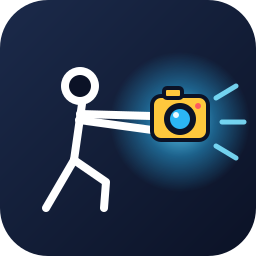
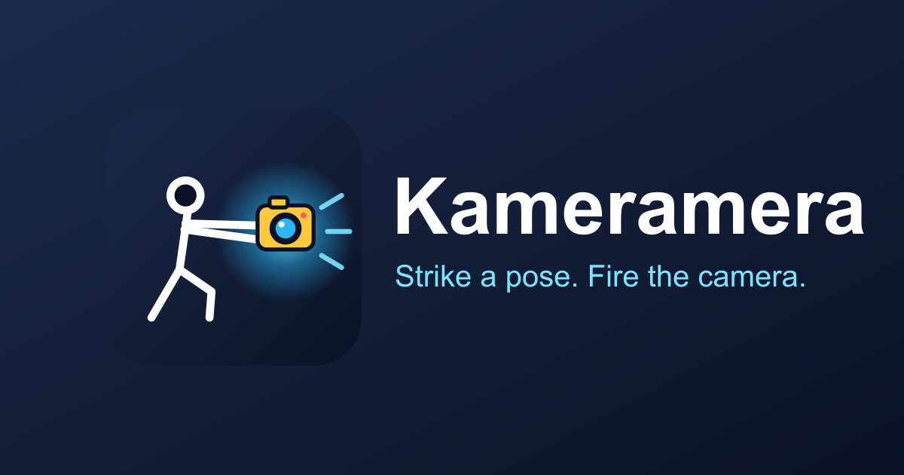
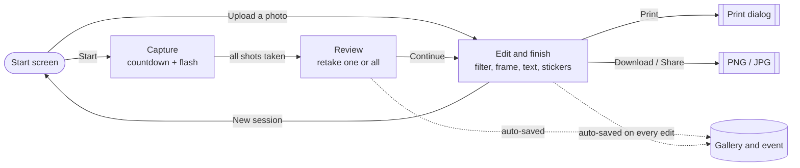
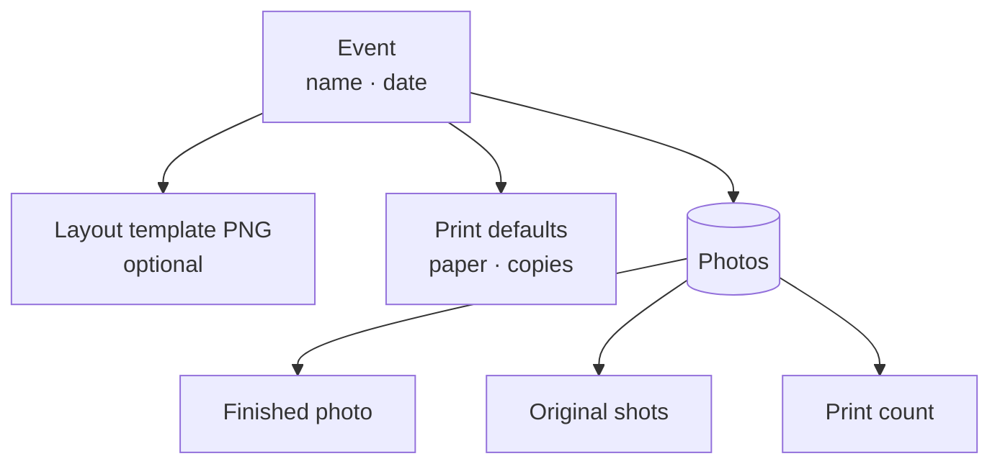
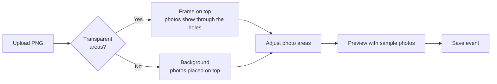
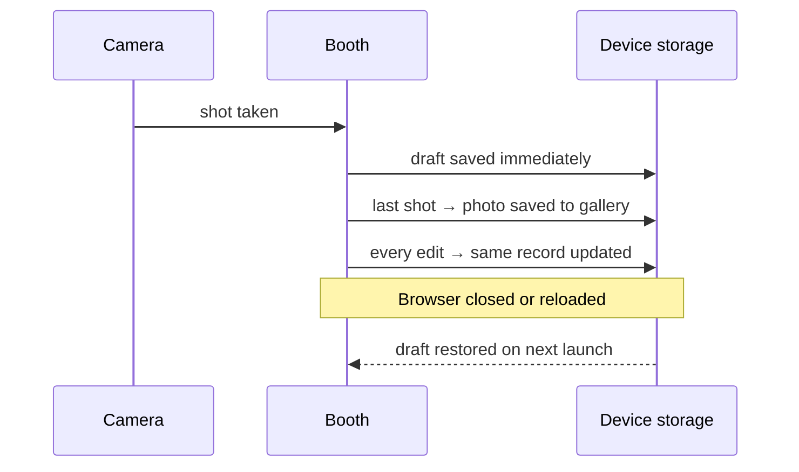
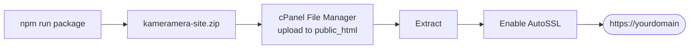

<p align="center">
  
</p>

<h1 align="center">Kameramera</h1>

<p align="center">
  <b>An event photobooth that runs entirely in the browser.</b><br />
  Capture, style, print and hand over photos. No server, no accounts, and photos never leave the device.
</p>

<p align="center">
  
</p>

---

## Contents

- [At a glance](#at-a-glance)
- [How a session works](#how-a-session-works)
- [The booth](#the-booth)
- [Editing a photo](#editing-a-photo)
- [Events](#events)
- [Layout templates (your own PNG)](#layout-templates-your-own-png)
- [Printing](#printing)
- [Gallery](#gallery)
- [Exporting for clients](#exporting-for-clients)
- [Never losing a photo](#never-losing-a-photo)
- [Keyboard shortcuts](#keyboard-shortcuts)
- [Branding](#branding)
- [Running locally](#running-locally)
- [Deploying to cPanel (Namecheap)](#deploying-to-cpanel-namecheap)
- [Project structure](#project-structure)
- [Limitations and tips](#limitations-and-tips)

---

## At a glance

| | Feature | What it does |
|---|---|---|
| 📸 | **Capture** | Live camera preview, 3/5/10 s countdown, flash and shutter sound, front/back camera switch |
| 🎞️ | **Layouts** | Single shot, 4-photo strip, 2×2 grid, or your own **event template PNG** |
| 🎨 | **Editing** | 7 filters, frame colours, glow border, caption, event name and date, emoji stickers |
| 🗂️ | **Events** | One photo collection per event, each with its own template and print defaults |
| 🖨️ | **Printing** | 4×6, 5×7, 6×8, A4, A5, Letter, or **2 strips on one 4×6**, with copies and fit options |
| 🔢 | **Print counter** | Every photo shows how many times it has been printed |
| 🖼️ | **Originals** | Full-size individual shots are kept alongside the finished photo |
| 📦 | **Export** | One ZIP per event: finished photos plus an `originals/` folder |
| 💾 | **Crash-safe** | Every shot is saved as it is taken, and sessions resume after a reload |
| 📱 | **Works anywhere** | Responsive full-screen layout and installable as an app (PWA) |

---

## How a session works



Every finished photo is saved to the **gallery** automatically, and to the **active event** when one is selected. Edits replace the same record, so a photo is never duplicated.

---

## The booth

### Start screen

```
┌───────────────────────────────────────────────────────────────────────┐
│                         [ logo ]                                      │
│                 Strike a pose. Fire the camera.                       │
│                                                                       │
│ ┌ Event: Maria & Jon's Wedding ─────────────────────────── [Change] ┐ │
│                                                                       │
│ ┌ Mode ─────────────┐ ┌ Layout ───────────┐ ┌ Timer ───────────────┐ │
│ │ [Event template]  │ │ [4-Photo Strip]   │ │ [3s] [5s] [10s]      │ │
│ │ [Single] [Strip]  │ │ [2x2 Grid]        │ │ Pause: [2s][3s][5s]  │ │
│ └───────────────────┘ └───────────────────┘ └──────────────────────┘ │
│ ┌ Options ───────────────────────────────────────────────────────────┐ │
│ │ ☑ Mirror preview and photos  ☑ Shutter sound  ☑ Watermark          │ │
│ └────────────────────────────────────────────────────────────────────┘ │
│                        [        START        ]                        │
│                        [ Or upload a photo ]                          │
└───────────────────────────────────────────────────────────────────────┘
```

| Setting | Choices |
|---|---|
| **Mode** | *Event template* (only when the active event has a template) · *Single shot* · *Photo strip* |
| **Layout** (strip mode) | *4-Photo Strip* (vertical) · *2×2 Grid* |
| **Timer** | 3, 5 or 10 seconds per shot |
| **Pause between shots** | 2, 3 or 5 seconds |
| **Options** | Mirror the preview and photos · shutter sound · Kameramera watermark |
| **Upload a photo** | Skip the camera and style an existing image |

### Built-in layouts

```
  Single            4-Photo Strip        2×2 Grid
 ┌────────┐          ┌──────┐          ┌────┬────┐
 │        │          │  1   │          │ 1  │ 2  │
 │   1    │          ├──────┤          ├────┼────┤
 │        │          │  2   │          │ 3  │ 4  │
 ├────────┤          ├──────┤          ├────┴────┤
 │ footer │          │  3   │          │ footer  │
 └────────┘          ├──────┤          └─────────┘
                     │  4   │
                     ├──────┤
                     │footer│
                     └──────┘
```

The **footer** holds the caption or event name, the date, and the optional watermark.

### Capture screen

On large screens the camera fills the left side and the controls sit in a side panel. On phones they stack.

- **Big yellow button** (or **Space**) starts the countdown.
- **Progress dots** show which shot is next: yellow means current and cyan means taken.
- **Flip** switches between front and back cameras.
- **Filter chips** preview the filter live on the camera.
- **Cancel** stops mid-sequence.
- The session pauses automatically if the tab is hidden or the camera is unplugged.

Camera errors are shown in plain language: permission denied, no camera, camera in use, needs HTTPS, or camera disconnected.

### Review screen

Every shot is shown as a thumbnail with its own **Retake** button. **Retake all** starts the sequence again, and **Continue** opens the editor.

---

## Editing a photo

```
┌──────────────────────────────────────────────┬────────────────────────────┐
│                                              │ [Filter][Frame][Text][Stk] │
│                                              │                            │
│             Large live preview               │   tab content              │
│      (drag stickers directly on it)          │                            │
│                                              ├────────────────────────────┤
│                                              │ [         PRINT          ] │
│                                              │ [Download PNG][Download JPG]│
│                                              │ [Share]   [Back to review] │
│  Saved to Maria & Jon's Wedding. View gallery│ [New session]              │
└──────────────────────────────────────────────┴────────────────────────────┘
```

| Tab | Options |
|---|---|
| **Filter** | Normal · B&W · Sepia · Vintage · Warm · Cool · Punchy |
| **Frame** | Navy · White · Yellow · Cyan · Blue · Red · Black, plus a **Kame style** preset, cyan glow border, and watermark on/off |
| **Text** | Caption (up to 40 characters) · **Event name and date** (on by default when an event is active) · date stamp |
| **Stickers** | 12 emoji. Tap to add, drag to move, **Smaller / Larger / Delete** |

Footer typography uses **Montserrat ExtraBold** for the headline and **Open Sans** for the detail line.

> When an event template is in use, only **Filter** and **Stickers** are shown, because the template controls the rest of the design.

---

## Events

An event is a photo collection with its own settings. Create one before the party, select it, and every photo taken goes into it.



| Action | Where |
|---|---|
| Create or edit an event (name, date, paper, copies, template) | **Events → New event / Edit** |
| Make it the active event | **Use this event** |
| See only its photos | **View photos** |
| Download everything | **Export ZIP** |
| Remove it **and all its photos** | **Delete → Confirm** |

The active event is remembered between restarts and shown on the start screen.

---

## Layout templates (your own PNG)

Upload a sample PNG while preparing an event, and the booth places photos into it.



**Template editor**

- **Auto-detect areas** finds each transparent window in the PNG.
- **Drag** an area to move it, or drag its yellow corner to resize it. Arrow keys nudge it.
- **Add photo area** and **Remove selected** let you place areas by hand.
- **Number by position** orders areas top-to-bottom, then left-to-right. This is the shooting order.
- **Frame on top / Background** switches how the PNG is layered.
- **Preview** fills the template with numbered sample images so you can check it without a camera.

> Each shot is captured in the shape of the first photo area, so keep all areas the same shape for the best fit.

---

## Printing

Printing uses the browser's print dialog, so any printer the computer can see will work, including dedicated photo printers.

| Paper | Notes |
|---|---|
| 4×6 in · 5×7 in · 6×8 in | Standard photo sizes. Landscape images rotate the page automatically |
| A4 · A5 · Letter | Office paper |
| **2 strips on 4×6** | Two copies of a strip side by side, ready to cut in half |

```
     2 strips on 4×6
   ┌──────┬──────┐
   │ ▢▢▢▢ │ ▢▢▢▢ │   ← one sheet
   │ ▢▢▢▢ │ ▢▢▢▢ │
   │ ▢▢▢▢ │ ▢▢▢▢ │
   │ ▢▢▢▢ │ ▢▢▢▢ │
   └──────┴──────┘
         ✂ cut
```

- **Copies** (or **Sheets** for 2-strip) are set with a − / + stepper, from 1 to 50.
- **Fit**: *Whole image* (no cropping) or *Fill page* (may crop).
- Each event has default paper and copy settings, which are pre-filled in the dialog.

> In the browser's print window, pick the **same paper size**, set **Margins: None** and **Scale: 100%**.

---

## Gallery

```
 [All photos] [Maria & Jon] [Corporate Party] [No event]       12 photos
 ┌────────┐ ┌────────┐ ┌────────┐ ┌────────┐ ┌────────┐ ┌────────┐
 │     (2)│ │     (0)│ │     (1)│ │     (4)│ │     (0)│ │     (1)│
 │  📷    │ │  📷    │ │  📷    │ │  📷    │ │  📷    │ │  📷    │
 └────────┘ └────────┘ └────────┘ └────────┘ └────────┘ └────────┘
              (n) = number of times printed
```

- **Filter chips** switch between all photos, a single event, or photos without an event.
- Each thumbnail has a **print-count badge**, yellow once it has been printed.
- Opening a photo shows it full-screen with **Print**, **Download**, **Share**, **Delete** (with confirmation) and a list of the **original shots**. Each original can be downloaded individually, or all of them together as a ZIP.

---

## Exporting for clients

**Events → Export ZIP** downloads every photo of the event:

```
maria-jon-s-wedding-2026-10-27.zip
├── maria-jon-s-wedding-001.png          ← finished photo (layout, filter, frame…)
├── maria-jon-s-wedding-002.png
├── …
└── originals/
    ├── maria-jon-s-wedding-001/
    │   ├── maria-jon-s-wedding-001-1.jpg   ← full-size shot as captured
    │   ├── maria-jon-s-wedding-001-2.jpg
    │   └── …
    └── maria-jon-s-wedding-002/
        └── …
```

Originals are the camera captures before any layout, filter, frame or stickers. They are what clients usually ask for.

| Browser | How the export is saved |
|---|---|
| **Chrome / Edge (desktop)** | A save dialog opens, and the ZIP is streamed straight to disk with progress shown. Works for events of any size. |
| **Other browsers** | Downloaded automatically, split into ZIPs of about 400 MB (`…-part1-of-3.zip`). A photo and its originals always stay in the same part. |

---

## Never losing a photo



- Each shot is written to on-device storage (IndexedDB) the moment it is taken.
- After a reload, crash or accidental tab close, the session reopens on the **review** or **editor** screen with all shots and edits intact.
- Every finished photo is auto-saved. **New session** will not clear the screen if saving failed.
- The app asks the browser for **persistent storage**, so photos aren't evicted when disk space runs low. The Events page warns you if the browser refuses.

---

## Keyboard shortcuts

| Key | Where | Action |
|---|---|---|
| <kbd>Space</kbd> | Capture | Start the countdown |
| <kbd>←</kbd> <kbd>→</kbd> <kbd>↑</kbd> <kbd>↓</kbd> | Editor (sticker focused) | Move sticker |
| <kbd>Delete</kbd> / <kbd>Backspace</kbd> | Editor (sticker focused) | Remove sticker |
| <kbd>←</kbd> <kbd>→</kbd> <kbd>↑</kbd> <kbd>↓</kbd> | Template editor (area focused) | Nudge photo area |
| <kbd>Esc</kbd> | Gallery | Close the open photo |

All controls are buttons with visible focus rings. Animations are turned off when the system asks for reduced motion.

---

## Branding

Colours come from the logo and are defined as Tailwind tokens in `tailwind.config.ts`.

| Token | Colour | Used for |
|---|---|---|
| `navy-900` |  `#0B1226` | App background, text on yellow |
| `navy-700` |  `#1B2A4A` | Cards and panels |
| `kame-yellow` |  `#FFC83D` | Primary buttons, capture button, highlights |
| `kame-blue` |  `#2BB6F5` | Secondary actions, focus rings |
| `kame-cyan` |  `#7DE3FF` | Glow, progress, section titles |
| `rec` |  `#FF5A5F` | Delete and error states |

| Typeface | Used for |
|---|---|
| **Fredoka** | App interface and watermark |
| **Montserrat ExtraBold** | Photo footer headline (event name or caption) |
| **Open Sans** | Photo footer detail line (date) |

---

## Running locally

Requires **Node.js 20+**.

```bash
npm install
npm run dev
```

Open <http://localhost:3000> and allow camera access. The camera only works on `localhost` or over **HTTPS**.

| Script | Purpose |
|---|---|
| `npm run dev` | Development server with hot reload |
| `npm run build` | Static production build into `out/` |
| `npm run package` | Build and write `kameramera-site.zip` for upload |
| `npm run typecheck` | TypeScript check |
| `npm run icons` | Regenerate PNG icons and `og-image.png` from `public/logo.svg` |

To test on a phone, the page must be served over HTTPS. Use a tunnel such as `npx localtunnel --port 3000`, or deploy.

---

## Deploying to cPanel (Namecheap)

The app is a **static export**, so no Node.js hosting is needed.



1. Run `npm run package`. This builds `out/` and writes `kameramera-site.zip`.
2. In cPanel, enable **AutoSSL** (or Let's Encrypt) for the domain. The camera requires HTTPS.
3. In **File Manager**, open `public_html` (or the subdomain's folder), upload `kameramera-site.zip`, and **Extract** it.
4. Turn on **Show Hidden Files** and confirm `.htaccess` is present. It forces HTTPS, sets caching and allows camera access.
5. Open the site over `https://` and test the camera on desktop and mobile.

### Deploying to a subfolder

To serve from a path such as `https://example.com/booth/`:

```powershell
$env:NEXT_PUBLIC_BASE_PATH="/booth"; npm run package
```

Then change `ErrorDocument 404 /404.html` in `.htaccess` to `/booth/404.html`.

### Optional settings

| Variable | Purpose |
|---|---|
| `NEXT_PUBLIC_BASE_PATH` | Serve from a subfolder |
| `NEXT_PUBLIC_SITE_URL` | Absolute URL for social-share preview images |

---

## Project structure

```
src/
├── app/                    Pages: / (booth), /events, /gallery
├── components/
│   ├── Booth.tsx           Screen router: start → capture → review → result
│   ├── StartScreen.tsx     Mode, layout, timer, options, upload
│   ├── CaptureScreen.tsx   Camera, countdown, flash, progress
│   ├── ReviewScreen.tsx    Per-shot retake
│   ├── ResultScreen.tsx    Editor tabs, print, download, share
│   ├── EventsManager.tsx   Event list, export, delete
│   ├── EventEditor.tsx     Event details and print defaults
│   ├── TemplateEditor.tsx  Photo-area editor for template PNGs
│   ├── Gallery.tsx         Grid, filters, print count, originals
│   ├── PrintDialog.tsx     Paper, copies, fit
│   └── SessionKeeper.tsx   Saves and restores the in-progress session
├── hooks/                  useCamera, useCountdown
├── lib/
│   ├── compose.ts          Canvas rendering of layouts and templates
│   ├── filters.ts          Filters, with a per-pixel fallback for Safari
│   ├── template.ts         Transparent-area detection
│   ├── print.ts            Print-page generation
│   ├── storage.ts          IndexedDB: photos, events, drafts
│   ├── session.ts          Auto-save of the current session
│   └── exportZip.ts        Event and originals ZIP export
└── store/booth.ts          App state (Zustand)
```

**Stack:** Next.js (static export), React, TypeScript, Tailwind CSS, Zustand, `idb` (IndexedDB) and `fflate` (ZIP).

---

## Limitations and tips

- **Photos live in the browser** that took them, so use the same browser profile and the same web address for the whole event. Clearing site data deletes everything. **Export each event's ZIP afterwards.**
- **Large events export safely.** In Chrome and Edge on a computer, **Export ZIP** asks where to save and writes the ZIP straight to disk one photo at a time, so event size isn't limited by memory. Other browsers download the event in parts of about 400 MB (`…-part1-of-3.zip`). Allow multiple downloads for the site if the browser asks.
- **The print counter** increases when the print window opens. The browser cannot report whether the job was actually printed or cancelled.
- **Close other tabs of the app** after an update so the storage upgrade can finish.
- For long events, **install the app** (browser menu → *Install Kameramera*). This makes it run full-screen and helps keep storage protected.
